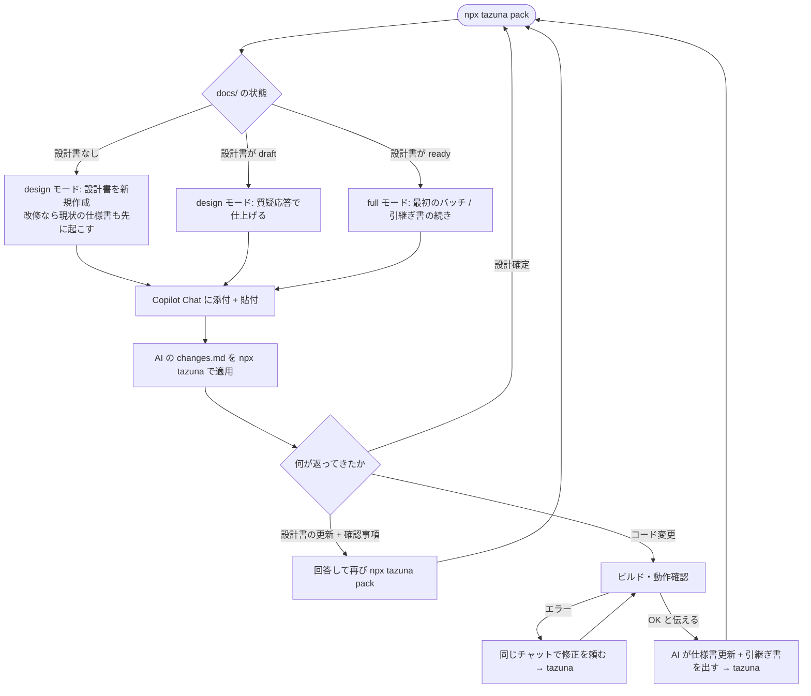

# tazuna + M365 Copilot Chat 運用ガイド

「次に何を打てばいいか」を迷ったときに開くページです。tazuna 0.15.0 以降を前提にしています
(以前の `npx petari` は `npx tazuna`、`npx slnmix` は `npx tazuna pack` になりました。下の「petari / slnmix から
移るとき」)。仕組みの背景は
[HANDOFF-slnmix-petari-2026-09.md](HANDOFF-slnmix-petari-2026-09.md) §18・§25 に
ありますが、日常ではこのページだけで足ります。

### petari / slnmix から移るとき

| 以前 | 今 |
|---|---|
| `npx slnmix init` / `npx petari init` | `npx tazuna init` |
| `npx slnmix` (オプションも同じ) | `npx tazuna pack` |
| `npx slnmix build` | `npx tazuna build` |
| `npx petari` / `watch` / `undo` / `show` / `list` | `npx tazuna` / `watch` / `undo` / `show` / `list` (引数は同じ) |

- `slnmix.config.json` は名前を変えなくても読まれます (新しく作るときは `tazuna.config.json`)
- 規約文は tazuna に内蔵になりました。`protocol.md` は手を加えていなければ消してかまいません
  (`npx tazuna pack` が「削除してかまいません」と案内します。消さなくても動きます)
- `docs/`・`.petari/` (適用の履歴と PC ごとの設定)・`.gitignore` の行・設計書の状態行
  (`<!-- slnmix design: ... -->`) はそのままです。`.petari/` だけがあるリポジトリでは tazuna もそれを使い続け、
  `.tazuna/` は作りません (新しく始めるリポジトリは `.tazuna/`)
- `npx petari` と `npx slnmix` もしばらくは動きます (tazuna を呼ぶだけです。実行のたびに移行を知らせる 1 行が出ます)

## 0. 30 秒版

```text
初回だけ   npx tazuna init            (リポジトリ直下で。構成の判定・docs/・.gitignore・
                                       .tazuna/ をまとめて作る)

作業の始めに npx tazuna watch         (別の端末で起動したままにする。Ctrl+C で終了)

毎回       npx tazuna pack            → 貼るものがクリップボードに入る
           Copilot Chat: 本文に貼って送信 (パックが大きいときだけ .xml も添付。
                         どちらかは実行末尾の 1 行に出る)
           AI の changes.md をダウンロード → watch が自動で適用
                                       (watch を使わないときは npx tazuna)
           npx tazuna build           → 失敗ならエラーと周辺のコードがクリップボードに入る
                                         → チャットに貼る
           pnpm test:all              → 失敗ならクリップボードのレポートをチャットに貼る
           手動確認は引継ぎ書の手動項目だけ → 「OK」と AI に伝える
```

自動テストが無いプロジェクト (旧 WinForms のみ等) では `pnpm test:all` の行が無く、
「ビルド・動作確認 → 結果を AI に伝える」になります (AI にもテストは求められません)。
`npx tazuna build` は MSBuild でビルドするコマンドで、Visual Studio で
ビルドしてエラー一覧をコピーする代わりに使えます。成功すれば何もコピーしません。

設計から始めるか、実装の続きか、引継ぎ書を書くかは tazuna と AI が決めます。
あなたが打つコマンドは `npx tazuna pack` と `npx tazuna` (テストがあれば `pnpm test:all`) だけです。
`npx tazuna watch` を起動しておけば、毎回の `npx tazuna` も要りません。
watch はブラウザのダウンロード先とコードが同じ PC にあるときに使えます。リモート
デスクトップ越しに changes.md を受け渡す運用では、従来どおり `npx tazuna` / `npx tazuna --clip` です。
web と dotnet を分けたアプリ (webview2-bridge の雛形。`.sln` は `dotnet/` の下) でも同じです。
雛形に同梱の設定ファイル (`slnmix.config.json`。`target` と `extraRoots`) がアプリのルートにあるので、
そこで `npx tazuna pack` と打てばアプリのルート基準のパックになり、変更を当てるときのルートと一致します。
VB.NET 以外のプロジェクト (TypeScript・Python・C# など。`.sln` が無い) も、初回の `npx tazuna init` が
generic 構成の設定を作るので、あとは同じです (3-7)。

## 1. 登場するもの

| もの | 場所 | 役割 |
|---|---|---|
| パック | `repomix-output.xml` | コード全文 + docs/ の全文書。約 120K 文字以内なら丸ごと本文に**貼る** (クリップボードに入っている)。超えるときは Copilot Chat に**添付**する |
| 本文用テキスト | `repomix-output.prompt.md` | 依頼内容・今回編集する文書・ひな型・作業手順・出力規約。パックを添付するときに本文に**貼る** (このときはこちらがクリップボードに入っている) |
| 設計書 | `docs/design/<名前>.md` | 開発の進め方と判断の根拠。1 行目の状態行で draft / ready を管理 |
| 仕様書 | `docs/spec/<名前>.md` | 実装済みの振る舞いの正本 |
| 引継ぎ書 | `docs/HANDOFF.md` | チャット間の申し送りだけ (1 ファイル固定。履歴は git) |
| changes.md | Downloads | AI の回答。コードも文書も同じ形式で、tazuna が適用する |
| 規約文 | tazuna に内蔵 | changes.md の書き方の規約。パックと本文用テキストに自動で入る (ルートに `protocol.md` を置くと、その内容で上書きできる) |
| 自動テスト | `e2e/` (screen / api / host) と `*.spec.ts` / `*.test.ts` | webview2-bridge の雛形が作る。あるプロジェクトでは AI がコードと同じ changes.md でテストも返す |
| 失敗レポート | `test-results/report.md` | `pnpm test:all` が失敗したときの Markdown。クリップボードにも入るのでそのままチャットに貼る |

添付と貼付を分ける理由: Copilot Chat は添付ファイル内の指示を「埋め込み指示」として
無視します。指示が効くのは本文だけなので、AI に従わせたいものはすべて
`.prompt.md` 側に入っています。パックは検索して参照される側です。
パックが小さいときは本文に丸ごと貼れば全文がコンテキストに入り、埋め込みの指示も
効くので、`tazuna pack` はパック全体をクリップボードに入れます (添付は不要)。
以下の手順の「添付 + 貼付」は、パックが小さいときは「貼付だけ」と読み替えてください。

## 2. 全体の流れ



## 3. 場面別の手順

### 3-1. 新しい画面・機能を作り始める (設計書がない)

1. `npx tazuna pack` → 「モード: design (自動: 設計書がないため新規作成)」と出る
2. 新しいチャットにクリップボードの中身を貼り (大きいときは .xml も添付)、続けて「この画面を作りたい。
   資料は添付のとおり」と依頼と資料 (テーブル定義、既存画面のパック等) を渡す
3. AI が設計書の初版 (changes.md の create) と確認事項 (必須 / 後回し) を返す
4. `npx tazuna` で docs/design/ に保存される
5. 確認事項に答えるたびに `npx tazuna pack` → 同じ要領で送る。設計書は本文用テキストに
   全文が入るので、AI は差分だけを replace で返す
6. 必須の確認事項がゼロになった回で AI が「継続判定: 設計確定」と言い、仕様書の
   初版も同じ changes.md に含める。`npx tazuna` で保存したら設計は終わり

途中で別の画面の設計を始めたいときは `npx tazuna pack --design 画面名` で新規作成。
draft の設計書が 2 つ以上あるときは `--design <名前>` で対象を指定します。

### 3-2. 実装を進める (設計書が ready)

1. `npx tazuna pack` → 「モード: full (自動: 設計書が ready ...)」と出る。引継ぎ書があれば
   「続きから」、なければ最初のバッチから
2. 新しいチャットに添付 + 貼付。依頼文は既定で入っているので、追加で言うことは
   通常ありません
3. AI が changes.md (コードと、テストがあるプロジェクトならテストも) を返す →
   `npx tazuna` → `npx tazuna build` → `pnpm test:all`
4. ビルドエラーならクリップボードに入っているエラーと周辺のコードを、テストが失敗したら
   クリップボードに入っている失敗レポート (`test-results/report.md`) を、同じチャットに
   貼って修正を頼む (→ 3 に戻る)
5. 全件通ったら、手動確認は引継ぎ書 (設計書 §9 の「完了条件: 手動確認」) の項目だけ
   行い、「ビルド OK、テスト OK、手動確認 OK」と伝える。AI はその回答で仕様書の更新と
   引継ぎ書の書き直しを changes.md で返し、チャット移行を案内する。テストが無い
   プロジェクトでは従来どおり「ビルド OK、動作確認 OK」
6. `npx tazuna` → `npx tazuna pack` → 新しいチャットへ (→ 1 に戻る)

続けて同じチャットで次のバッチをやりたいときは「このチャットで続ける」と言えば
続きます。

### 3-3. 既存プロジェクトを乗せ替える (設計書と引継ぎ書を手動添付している)

1. `npx tazuna init` (一回だけ。リポジトリ直下で)
2. 設計書を `docs/design/<名前>.md` にコピーし、**1 行目**に状態行を足す。実装中なら
   ready。後回しの件数は未回答の確認事項を数える (分からなければ 0 で可)

   ```text
   <!-- slnmix design: status=ready blocking=0 deferred=3 -->
   ```

3. **最新の**引継ぎ書 1 通を `docs/HANDOFF.md` にコピーする。古い引継ぎ書は docs/ の
   外へ。中の規約や手順のコピーは消してよい (`tazuna pack` が毎回付ける)
4. `npx tazuna pack` → 「文書: 設計書 1 件 [ready ...] / 仕様書 0 件 / 引継ぎ書あり」
   「モード: full (自動: ... 続きから)」と出れば完了
5. 仕様書がないことは `tazuna pack` が AI に伝えるので、最初の回答で仕様書の初版が
   changes.md で返る。`npx tazuna` で保存

docs/ と設定ファイル (`tazuna.config.json`。作られていれば) は git にコミットしてください。
生成物の repomix-output.xml と .prompt.md は init が .gitignore に追記済みです。

### 3-4. 完成済みプロジェクトに仕様追加する (文書が何もない)

設計書も仕様書もない既存プロジェクトを改修するときは、3-1 と同じ操作で始められます。
違いは AI が最初に作る文書です。

1. `npx tazuna init` (一回だけ。リポジトリ直下で)
2. `npx tazuna pack` → 「モード: design (自動: 設計書がないため新規作成)」
3. 新しいチャットに添付 + 貼付し、「この画面にこういう仕様を追加したい」と依頼する
4. AI はまず**改修対象の画面・機能に限った現状の仕様書** (as-is) をコードから起こし、
   同じ changes.md で追加仕様の設計書を出す。設計書の「1-3. 改修の場合: 現状と変更点」が
   仕様書の § を参照する形になる。`npx tazuna` で両方保存
5. 以降は 3-1 と同じ (確認事項に答える → 設計確定 → 実装)。実装が進むと仕様書の
   実装状況が「未」から「実装済み」に更新されていく

プロジェクト全体の仕様書を一度に起こすことはしません (量が多すぎて品質もチャットも
持たないため)。別の画面を改修するときに、その画面の仕様書が同じ要領で増えていきます。
先に全体を文書化しておきたい場合は、画面ごとに「この画面の現状の仕様書を起こして」と
依頼して `npx tazuna` で保存していけば、後の改修が速くなります。

### 3-5. AI から「継続判定」が返ってきたとき

| 表示 | 意味 | あなたがすること |
|---|---|---|
| 継続判定: 継続 | このチャットで続ける | そのまま次の依頼や回答を送る |
| 継続判定: 引継ぎ | バッチ完了。引継ぎ書の changes.md が一緒に返っている | `npx tazuna` → `npx tazuna pack` → 新しいチャットへ。続けたければ「このチャットで続ける」 |
| 継続判定: 引継ぎ推奨 (理由) | changes.md 3 回以上 / 失敗レポート 2 回 / パック再添付 のどれか | 切り替えるなら「引継ぎ書を出して」と頼む。続けるなら続ける |
| 継続判定: 設計確定 | 必須の確認事項ゼロ (design モード) | `npx tazuna` → `npx tazuna pack` → 新しいチャットで実装開始 |

「引継ぎ」の条件である「ビルドと動作確認の成功」は、自動テストがあるプロジェクトでは
「`pnpm test:all` が全件成功し、引継ぎ書の手動項目も OK」と読み替えます。テストが
1 本でも落ちているうちは修正のラリー (継続) です。

同じエラーに 2 回以上失敗しているときは、失敗した試行が残るチャットより、
修正途中のコードを含む最新パックで始め直す方が早いことが多いです。途中で引き継ぐと
引継ぎ書に「未解決のエラーと試したこと」が残るので、次のチャットは同じ試行を
繰り返しません。

### 3-6. tazuna が失敗したとき

失敗レポートは既定でクリップボードにコピーされます。そのままチャットに貼れば AI が
修正版の changes.md を返します。watch はその修正版 (`changes (1).md` などの連番付きで
保存されます) を自動で当てます。失敗した changes.md は当て直しません。2 回続けて失敗したら、AI が見ているパックと手元の
コードがずれています。`npx tazuna pack` でパックを作り直し、新しいチャットで始めてください
(引継ぎ推奨が出ます)。

「この changes.md は適用済みです」と出て止まったら、ファイルの取り違えです。以前に当てた changes.md をもう一度渡しているので、最新の回答の
changes.md (`changes (1).md` などの連番付きでもそのまま使えます) を当ててください。
git で手動で戻したなど、本当に当て直したいときだけ `--force` を付けます
(`npx tazuna undo` で戻したものは付けなくても当て直せます)。

### 3-7. VB.NET 以外のプロジェクト (TypeScript・Python・C# など) で使う

`.sln` / `.vbproj` の無いプロジェクトでも、`tazuna pack` → Copilot Chat → `tazuna` の流れは
そのまま使えます。本家 repomix で代用すると `.prompt.md` (本文に貼る手順文・規約文) が
作れず、添付末尾に埋めた規約文は Copilot に無視されるため、AI の返答が changes.md の
規約から外れてパースで落ちます。`tazuna pack` を使えばその経路を塞げます。

1. `npx tazuna init` (一回だけ。リポジトリ直下で)。`.sln` / `.vbproj` が無いので、
   `tazuna.config.json` に `"kind": "generic"` だけを書く
2. 以降は 0 章と同じ。`npx tazuna pack` が「対象: generic 構成」と表示し、**git が管理しているファイル**
   (コミット済みのものと、`.gitignore` に一致しない未コミットのもの) でパックと `.prompt.md` を作る。
   バイナリ・ロックファイル (`package-lock.json` など)・256KB を超えるファイル・`node_modules` / `dist` /
   `build` / `.env*` は除き、理由をパックの `<skipped_files>` に残す。手順文は VB 固有の項目を外した
   文面 (先頭行に `layout: generic`) になる
3. docs/ 連携・継続判定・自動テストの節も同じように使える (init が docs/ も作る)

対象を絞りたいときは、`.repomixignore` (書き方は `.gitignore` と同じ) に除外を書くか、
`tazuna.config.json` の `extraRoots` に `{ "path": "src", "kind": "src" }` のようにディレクトリを書きます
(`extraRoots` を書くと、git の一覧ではなく書いたディレクトリだけになります。`kind: "src"` の `include` の既定は
`**/*.{ts,tsx,js,jsx,mjs,cjs,css,scss,json,html,md}` なので、他の言語なら `include` も書いてください)。
git のリポジトリでないフォルダでは `extraRoots` が必要です (init が `src` / `tests` などの実在するディレクトリを書きます)。

認証情報の自動マスクは、TypeScript / JavaScript・Java・C#・Go・Python では文字列とコメントの中だけを伏せ、
`process.env.API_KEY` のようなコードは伏せません (AI がコードを読めるように)。

### 3-8. テスト用 DB の値を確かめる (ashiato)

AI に DB の値を推測させず、確認用の SELECT を書かせて手元で実行し、結果を貼ります。
DB に接続するのは ashiato だけで、実行するのは SELECT だけです (1 文でも違えば 1 文も
実行しません)。接続には SELECT だけを許可したユーザーを使い、テスト用 DB の値を
チャットに貼ってよいかは社内の決まりに従ってください。

0. 一回だけ: `npm install -g ashiato mssql oracledb` (使う DB のドライバーだけでよい) で
   ashiato を入れる。グローバルに入れておくと、アプリのルートで `npx ashiato ...` が
   そのまま動く。社内のレジストリに ashiato が無いときは、パッケージファイルから入れる
   (ashiato の docs/trial-guide.ja.md の 2-2)
1. 一回だけ: `npx ashiato schema --tables "<使うテーブル>"` でテーブル定義を
   `docs/db/schema.md` に書き出す (接続先は `--db` か環境変数 `ASHIATO_DB_URL`)。
   テーブルが変わったら打ち直す
2. 以降の `npx tazuna pack` が「DB の確認・動作検証: あり」と表示し、パックにテーブル定義を、
   手順文に「DB の確認」「動作検証」の節を入れる
3. AI は値の確認が要るとき、`checks/<名前>.sql` を changes.md で出し、回答の末尾に
   `npx ashiato query checks/<名前>.sql` を書く。tazuna で当ててからそのコマンドを打つと、
   結果 (文ごとの見出し・SQL・先頭 50 行) がクリップボードに入るので、チャットに貼る
4. SELECT 以外が混ざっていると「Nothing was run」で何も実行せず、理由がクリップボードに
   入る。そのままチャットに貼れば書き直してもらえる

### 3-9. 画面の操作で DB が期待どおりに変わるかを確かめる (ashiato verify)

3-8 と同じ準備 (`docs/db/schema.md`) で、手順文に「動作検証」の節も入ります。どのアプリ
(旧 WinForms・Web 画面・バッチ) でも使えます。ashiato は 0.2.0 以降が必要です。

1. AI は動作を確かめるとき、`checks/<名前>.verify.md` (手順ごとの操作と、期待する DB の
   変化) を changes.md で出し、回答の末尾に `npx ashiato verify checks/<名前>.verify.md`
   を書く。tazuna で当ててからそのコマンドを打つ
2. 手順が 1 つずつ表示される。アプリで操作してから Enter を押す (画面に出たことなどを
   メモしたいときは、入力してから Enter。`s` で飛ばす、`q` で終わる)
3. 手順ごとに `✓ OK` か `✗ NG` が出る。NG のときは違いが表示され、書き込みが遅れていた
   だけなら `r` でもう一度照合できる
4. 最後に、OK / NG とメモの表・期待との違い・変わった行がクリップボードに入るので、
   チャットに貼る。AI はそこから、コードの不具合か期待の書き違いかを判断する
5. 手順ファイルの書き方が違う・ないテーブルを書いていると「Nothing was checked」で何も
   照合せず、直すべき点がクリップボードに入る。そのままチャットに貼れば書き直してもらえる

テーブルが多い DB では、すべてのテーブルを読むと時間がかかります。`--tables "A,B,C"` で
見張るテーブルを絞ってください (手順ファイルに書かれたテーブルは含めます)。Excel の証跡が
要るときは `--save-session` を付け、表示された `ashiato export ...` を打ちます。

## 4. コマンド早見表

```text
npx tazuna init                    初回セットアップ (リポジトリ直下で。冪等)
npx tazuna pack                    パックと本文用テキストを作る (モード・依頼文は自動)
npx tazuna pack --task "依頼文"    依頼文を自分で指定する (既定文の代わり)
npx tazuna pack --design 画面名    その設計書を新規作成 / 継続する design モード
npx tazuna pack --mode plan        方針だけ先に出させる
npx tazuna pack --no-clip          クリップボードに入れない (既定は貼るものを自動でコピー)
npx tazuna pack --init-docs        docs/ 連携だけを設定する (init に含まれる)
npx tazuna pack --init-config      VB.NET 以外向けの tazuna.config.json だけを作る (init に含まれる)
npx tazuna build                   MSBuild でビルドし、失敗ならエラーと周辺のコードをコピー

npx tazuna watch                   起動したままにすると、届いた changes.md を確認なしで適用し続ける
npx tazuna                         Downloads の changes.md を適用
npx tazuna undo                    直前の適用を巻き戻す (続けて実行すると 1 つずつ前へ)
npx tazuna show                    直前の適用の差分を表示
npx tazuna protocol                内蔵の規約文を表示する (protocol.md で上書きしたいときの元に)

npx ashiato schema --tables "A,B"   テスト用 DB のテーブル定義を docs/db/schema.md に書き出す (3-8)
npx ashiato query checks/x.sql     AI が書いた SELECT を実行し、結果をコピー (3-8)
npx ashiato verify checks/x.verify.md  AI が書いた手順どおりに操作し、DB の変化の照合結果をコピー (3-9)
```

## 5. よくある迷い

- **モードが思っていたのと違う** → `npx tazuna pack` の「文書:」「モード:」の行を見る。
  設計書の状態行 (1 行目) が draft か ready かで決まる。手で直してよい
- **設計書に状態行がない** → 警告が出て ready 扱いになる。1 行目に足す
- **draft の設計書が複数ある** → `--design <名前>` で対象を指定する
- **AI が継続判定を書かない** → 「継続判定は?」と聞く。手順文は本文に貼った
  クリップボードの中身 (.prompt.md またはパック全体) にあるので、貼り忘れると出ない
- **クリップボードに入っていない** → 実行末尾の警告を見る。PowerShell が制限された
  環境などでは自動コピーできないので、従来どおり .prompt.md を開いて貼る
- **引継ぎ書が古い** → AI が出した changes.md を tazuna で当てていない。Downloads を確認
- **本文用テキストが 120K 文字を超えた** (警告が出る) → 設計書を分割するか、
  design モード以外では設計書は本文に入らないので、設計を確定させて実装に進む
- **`--mode design` でエラー** → docs/ 連携が要る。`npx tazuna init`
- **「.sln / .vbproj が見つかりません」** → 初めてなら `npx tazuna init` (VB.NET 以外も
  これで generic 構成になる。3-7)。VB.NET なら `.sln` のある場所で実行するか
  設定ファイルの `target` を書く
- **`.sln` が 2 段以上深い** → init は 1 段下までしか探さない。設定ファイル (`tazuna.config.json`) に
  `"target": "<パス>/<名前>.sln"` を書いてから `npx tazuna init` を打つ
- **「… が両方あります」で止まる** → `tazuna.config.json` と `slnmix.config.json` の
  どちらか一方を残す (中身を 1 つにまとめる)
- **パックに入れたくないファイルが入る (VB.NET 以外)** → `.gitignore` か `.repomixignore` に書く。
  入ったファイルはパックの `<directory_structure>` で確かめられる
- **パースが続けて失敗する (TS プロジェクトで repomix を使っている)** →
  規約文が本文に届いていない。`npx tazuna pack` に切り替えて `.prompt.md` を貼る (3-7)。
  当座は `npx tazuna protocol` の出力を本文に貼れば規約文だけは届く
